# sprint

A terminal coding agent for small local models. Two Python files, no dependencies.

<p align="center"></p>

<p align="center">
  <a href="https://sprintai.pages.dev"></a>
  <a href="https://github.com/Vasiniks/sprint/releases/latest"></a>
  <a href="https://github.com/Vasiniks/sprint/actions/workflows/ci.yml"></a>
  <a href="pyproject.toml"></a>
  <a href="#start"></a>
  <a href="LICENSE"></a>
</p>

<p align="center"><a href="https://sprintai.pages.dev"><b>sprintai.pages.dev</b></a>: the website, with a tour of what it looks like</p>

Small models are fast and private, but they lose track of long conversations, garble tool calls and go in circles. sprint is built around those failings: it keeps the context small, checks every tool call, stops loops, and shows you each action before it runs.

## Start

You need Python 3.9 or newer and [Ollama](https://ollama.com).

| system | status |
|---|---|
| macOS | Works; built and tested here. |
| Linux, WSL | Should work: same code paths as macOS. The tests run on Ubuntu in CI. |
| Windows | Written but not yet tried on a real machine. Commands run in Git Bash when Git for Windows is installed, otherwise in PowerShell. `pip install` adds `windows-curses` for the full screen. A CI job runs the Windows-only tests. |

```bash
pip install -e .
sprint
```

- If Ollama isn't running, sprint starts it and leaves it running.
- If the model isn't installed, sprint offers to pull it.
- The first model is magi 1.2 2B (`hf.co/GEHIRNS/magi-1.2-2B`, 826 MB), the one that did best in [the tests below](#what-to-expect). After that it opens with whichever model you used last.

Type a request and press Enter. In the default mode sprint asks before it runs a command or changes a file.

| from the shell | |
|---|---|
| `sprint` | open sprint in this folder |
| `sprint "fix the typo"` | open it with a first message |
| `sprint help` | list these, in sections (in colour on a terminal) |
| `sprint config` | open the settings file in your editor (`$VISUAL`, `$EDITOR`, else the system's text editor) |
| `sprint serve`, `sprint serve stop`, `sprint serve status` | start the local Ollama server, stop it, or say whether it is running |
| `sprint update` | get the newest sprint: `git pull` for a checkout, `pip install --upgrade` otherwise |
| `sprint --version` | the version |

Once a day sprint looks at this repository for a newer version and, if there is one, says so on the line above the version, in a colour of its own (`/update` gets it). The version is always bottom left: on the opening screen, and under your messages once a conversation is going. The look sends nothing but the request itself; `/config update_check off` stops it.

## The screen

| part | what it shows |
|---|---|
| Messages (left) | Your messages in order, each with what it took. Click one to jump to it; what you jump to lights up for a moment. The wheel over the list scrolls it, and the heading says which are on show (`4-12 of 31`). |
| Conversation (middle) | Your messages on a bright band with a bar down the side in the mode's colour, the model's replies, and one window per tool call. Under each answer, what the message cost: tokens up and down, and the time. |
| Sidebar (right) | At the top, the context window in small with how full it is; on a tall screen also a legend of what fills it, and the session in labelled rows (model, thinking, showthink, effort, plan, speed, tokens, tool calls, time; the mode is by the prompt). Then a log of every tool call and how it ended, which the wheel scrolls like the message list. In plan mode its bottom half is the model's to-do list, while it has one: how far along it is, and each item ticked, in hand, still to do or dropped; drag the line above it to give it more or less room. |
| Prompt (bottom) | The line you type on, between two rules, with the model and context on the upper one. Under it, the mode with its icon (`▰▱▱` ask, `▰▰▱` edits, `▰▰▰` auto: fuller, the more runs without asking) and a reminder that Tab cycles it. |
| Status (above the prompt) | While a turn runs: a sprint along a slanted track, then what is happening, for how long, tokens going up or coming down, and the effort, as in `answering (12s \| ↓ 340 tokens \| medium effort)`. A glint of colour crosses the words every couple of seconds. When a model goes quiet to write a tool call (the server holds a call back until it is whole), the line says `preparing the next step`. |

Tool windows start collapsed to a few lines, and each says how long the call took:

```
╭─ ▸ shell  python3 hello.py && seq 1 12 ─────────── done 0.1s ─╮
│ $ python3 hello.py && seq 1 12                                │
│ hi                                                            │
╰─ … +11 lines · ctrl+o ────────────────────────────────────────╯
╭─ ▾ edit  hello.py  +1 -1 ───────────────────────── done 0.0s ─╮
│ - print('hi')                                                 │
│ + print('hello world')                                        │
╰───────────────────────────────────────────────────────────────╯
```

Answers are coloured by what they are, not just printed: **bold** and *italic* each in a colour of their own, three levels of heading, list numbers and bullets, task boxes, quotes behind a bar, labels such as `Note:` `Warning:` `Error:` `Done:`, and in code blocks keywords, strings, numbers, function names, decorators and constants. A paragraph of ordinary sentences stays plain. Every theme recolours all of it.

Drag the line beside either side panel to resize it. A panel that would squeeze the conversation below 44 columns hides itself.

## Writing a message

| you type | what happens |
|---|---|
| `@notes.txt` | That file is attached to the message, so the model doesn't have to go and read it. Tab completes the name. |
| `/model` | A command, typed in full, lights up in the prompt, as do the files you attach and the chips of pasted things. One that switches or sets something also shows what it stands at now, at the far right (`/showthink` … `off`), and so does its row in the list of commands. |
| `!git status` | Shell mode: the prompt's `❯` becomes `!` and the bar takes the shell colour (green in most themes; ask, edits, auto and shell each have their own, in every theme). The command runs yourself: no model, no approval. Its output joins the conversation. |
| a pasted or dragged file | It becomes a chip: `[Image #1]`, `[PDF #1]` or `[File #1]`. Pictures go to the model as pictures, other files as text. |
| a large paste | It becomes a chip too, such as `[Pasted #1 +42 lines]`, so the prompt stays readable. The model gets the full text. |
| `ctrl+v`, `alt+v` or `/paste` | The picture on the clipboard (a screenshot, or a copied file) is attached as `[Image #1]`. Terminals paste text only, so sprint asks the system. In Windows Terminal use `alt+v` or `/paste`. |
| a message while it works | It waits in a queue shown above the prompt and runs when the turn ends. |
| `/` | The command list, with completion. |

## Keys

| key | |
|---|---|
| `enter` | send; while a turn runs, queue the message; on an empty prompt with messages queued, stop the turn and run them now |
| `shift+enter`, `alt+enter`, `ctrl+j`, or `\` then `enter` | a new line. Where the terminal sends shift+enter as a plain Enter (Apple's Terminal, the Windows console), sprint asks the system whether Shift is down; that cannot work over ssh, where the other keys do. |
| `tab`, `shift+tab` | switch mode: ask → edits → auto |
| `esc` | stop the turn at once (hangs up on the model, kills a running command); queued messages go back on the prompt |
| `ctrl+o` | expand or collapse all tool windows; click one to toggle just it |
| `ctrl+y` | copy the last answer |
| `ctrl+l` | clear the conversation |
| mouse wheel, `pgup`, `pgdn` | scroll. The wheel scrolls what the mouse is over: the conversation, or the list in either side panel. Scrolled up, a `↓ jump to bottom` button appears at the foot of the conversation: click it, or press `end` on an empty prompt. |
| `up`, `down` | recall earlier messages |
| `ctrl+c` | clear the line, else stop the turn; twice on an empty prompt to quit. If a turn will not stop, pressing on offers the way out all the same: nothing can keep you in. |

Drag over text to copy it: in the conversation, in the prompt, or in either side panel (a drag stays in the part of the screen it began in). `/mouse` hands the mouse back to the terminal if you prefer its own selection.

## Modes and permissions

| mode | runs without asking |
|---|---|
| `ask` (default) | reading files |
| `edits` | reading files anywhere; writing and editing files in the folder sprint is working in (one outside it is asked about) |
| `auto` | everything, except deleting the working folder or anything outside it |

The mode you leave in is the mode you come back to (starting with `-y` or `--mode` is for that run only).

When a call needs approval, the prompt asks: `y` once, `a` always, `n` no. One of the three is highlighted; left and right move it and Enter takes it. "Always" allows just that command or file from then on (a fetch allows the whole site). `/permissions` lists those rules, removes them, and adds patterns such as `shell git status*`.

**Deleting beyond the folder's contents always asks.** Files and folders inside the folder sprint is working in are the model's to tidy, under the mode's ordinary rules. But a command that would delete that folder itself (or everything in it, or a folder that holds it), or anything outside it, is put to you in every mode, `auto` included, and so is a deletion sprint cannot read (a `cd` first, a variable, `find -delete`, `git clean`, a one-line script). Such a call can be allowed once but never for ever; no allow rule covers it. If a command does remove the working folder, sprint steps up to the nearest folder that still exists and tells the model.

**sprint's own files always ask.** A model may read sprint's settings, your system prompt, the usage tallies and the log, but writing, editing or running a command that could change one of them (or `sprint config`) is put to you in every mode and can never be allowed for ever. A model that can rewrite the settings could put itself on the allow list.

**An approval nobody gives does not stall the work.** After 20 seconds (`/config ask_timeout N`; `0` waits for ever; any key starts the wait again) the call is set aside, not run: the model is told to carry on without it, and the prompt shows that something is waiting. `/permissions` lists what was set aside; Enter on one allows it once, and it runs the next time the model asks for it. (Plain mode, `--plain`, waits as long as it takes.)

## When the model asks you something

The model has a sixth tool, `ask`: a question for you, when only you can answer it, with choices if it has some to offer. It is never a thing to approve, whatever the mode.

- The question takes the prompt bar's place until you answer: what it asks, its choices as a numbered list, and a last row for an answer of your own. The current choice is marked and stands on a highlighted band; it starts on the first.

  ```
  ? Which colour should the button be?

  ❯ 1. red
    2. blue
    3. green
    4. Something else…
  ```

- The arrows move the highlight and Enter takes it. A choice's number takes it at once, and so does a click on it. Typing anything else writes your own answer on the last row; Tab puts the highlighted choice there to change.
- A choice too long for its row is shown whole once it is highlighted. On a short screen the choices scroll with the highlight, so the conversation keeps its room.
- Once it is over, the question and what you answered stand in the conversation.
- `esc` leaves it to the model. `ctrl+c` stops the turn.
- It waits one minute (`/config question_timeout N`; `0` waits for ever; any key starts the wait again). With no answer, the model is told to decide for itself, say what it chose, and carry on.
- What you were typing when the question came is put by and given back afterwards.
- It works with thinking on or off, and with a to-do list going. A folded conversation keeps your answers.
- `/config questions off` takes the tool away, and with it the line about it in the prompt. Models set against each other with `/race` are never offered it.
- In plain mode the question is printed and the next line you type is the answer; a number picks a choice.

## Commands

Anything a command brings up opens in the same popup, over a greyed-out screen: arrows or the mouse move, Enter or a click chooses, Esc or a click outside closes. A command given its value (`/mode auto`, `/effort high`) applies it and says so in the footer.

| command | |
|---|---|
| `/model [name]` | Pick an installed model, pull one by name, or search Hugging Face and pick a quantization. |
| `/race [model message]` | Send one message to two models and compare answers, time and speed. They may read files but change nothing. |
| `/mode`, `/permissions` | Change the mode; manage the always-allowed list. |
| `/think` | Let the model reason before answering. Its reasoning shows as it is written: a line that counts the words and shows the newest ones. |
| `/showthink` | Show that reasoning in full, growing as it arrives, in a dashed frame of its own so it never looks like an action. Otherwise it is one line; click one to open it. |
| `/effort low\|medium\|high` | How much room a reply always has, and how many steps a message may take (8, 16 or 32). |
| `/plan` | Whether the model may keep a to-do list, the way [opencode](https://github.com/anomalyco/opencode)'s agents do. On unless you switch it off. Nothing is planned up front and most messages get no list at all: the model has one more tool, `todowrite`, and reaches for it when a job is big (several files or parts). It sends the list with a state for each item (to do, in hand, done, dropped) and sends it again as it gets on. The list shows in the bottom half of the sidebar, and each update is one line in the conversation (click it for the list as it stood then; with the sidebar hidden the newest stands whole). Bringing the list up to date costs a message none of its steps. A finished list is put away when you send the next message; one with work left stays. `/plan` off takes the tool away. |
| `/context` | What is filling the context window, as a coloured grid. |
| `/usage` | Laid out after Claude Code's stats, in three pages; left and right (or Tab, a page's number, or a click on its name) turn them. **Overview**: the days as a heat map, a column to a week, darker the busier; under it the favourite model, total tokens, sessions, the longest session, active days, the current and longest streak, the most active day, the peak hour and tool calls, then what the tokens written amount to in pages of a book. **Models**: tokens per day as a line to a model on one chart, then every model with its share and its tokens in and out. **Session**: what only sprint knows about the one in hand: its counts, the tokens taken apart (per reply, the share that was reasoning, how much goes up for each token written), and what is in the window now. `r` goes round the date ranges (all time, the last 7 days, the last 30), `ctrl+s` copies the page on show, and up, down and the wheel scroll a page that does not fit. Sessions, their length and the hour of each message are counted from 0.4.18 on: a day from before counts as one session, and what was never recorded shows as a dash. |
| `/compact` | Fold the conversation into a short summary, at any time: everything before the latest exchange, or that exchange too when there is nothing older. sprint also does this by itself when room runs out. |
| `/copy [code\|all]` | Copy the last answer, the last code block, or everything. |
| `/paste` | Attach the picture on the clipboard. |
| `/export [file]` | Save the conversation as markdown. |
| `/directory [path]` | Change the folder sprint works in, with a small folder browser. |
| `/systemprompt` | Edit what the model is told at the start. |
| `/theme` | sprint (the one you get: near-black with the logo's colours), terminal (your terminal's own colours), mono, sapphire, midnight, slate, ocean, forest, grape, sunset, amber, matrix, paper. A theme sets the whole window, background included, right to its edges: while sprint runs, the terminal itself is given the theme's background (the margin round the text is the terminal's own colour, which nothing drawn can reach), and gets its own back when sprint leaves. Apple's Terminal is asked through the Terminal app; on Windows this is done in Windows Terminal only. The list previews each theme in its own colours. Terminals that say they show 24-bit colour (`COLORTERM=truecolor`; Apple's Terminal does from macOS 26) get the exact colours, without anything in the terminal's own palette being changed; others get the nearest of their 256. Sapphire follows [Tyriar's Sapphire](https://marketplace.visualstudio.com/items?itemName=Tyriar.theme-sapphire) for VS Code. |
| `/config [key value]` | Every setting, on two pages (left and right turn them). **General** is the everyday ones. **Advanced** is how the model chooses its next word: `temperature`, `top_p`, `top_k`, `min_p`, `repeat_penalty`, `repeat_last_n`, `presence_penalty`, `frequency_penalty` and `seed`, each with a line saying what it does. They go to the model server with every request. One you have not set says `default` and is not sent, so the model keeps its own value; Enter takes a number, and `default` hands it back (`/config temperature 0.7`, `/config temperature default`). A server that speaks the OpenAI way (`/v1`) is sent the five it knows: temperature, top_p, the two penalties and seed. |
| `/sidebar`, `/history` | Hide, show or size the side panels. |
| `/tools`, `/mouse` | Expand or collapse all tool windows; turn mouse capture on or off. |
| `/log` | The last things that happened, and where the full log is. |
| `/help` | Every key and command, in sections, a thing to a line. Type to narrow the list; Enter on a command puts it in the prompt. |
| `/update` | Get the newest sprint without leaving it (what `sprint update` does). It tells you which version a restart will bring, or that you already have the newest. |
| `/clear` (or `/new`), `/exit` | Start fresh, quit. |

## Settings and files

Everything sprint keeps lives in `~/.config/sprint/` (`%APPDATA%\sprint` on Windows), as plain files you can edit by hand:

| file | |
|---|---|
| `config.json` | settings: model, url, context size, steps, mode, effort, thinking, theme, timeout, how long an approval and a question of the model's wait, whether it may ask, panel sizes, allow list, recent folders, and any of the advanced ones you set (temperature and the rest) |
| `system.md` | your own system prompt, if you wrote one |
| `sprint.log` | messages, tool calls and errors, so there is something to read when a run goes wrong |
| `usage.json` | one tally per day of tokens, replies, time, tool calls, sessions (how many, and the longest) and messages by the hour; what `/usage` adds up |
| `update.json` | the newest version seen and when sprint last looked |

Command-line options override the environment, which overrides saved settings.

| option | |
|---|---|
| `sprint "fix the typo in README"` | start with a first message |
| `-m NAME`, `SPRINT_MODEL` | model |
| `-u URL`, `SPRINT_URL` | Ollama URL, or any OpenAI-compatible URL ending in `/v1`; `SPRINT_KEY` for a bearer token |
| `-c 8192` | context window in tokens |
| `--mode edits`, `-y` | starting mode; `-y` is auto |
| `--plain` | a line-by-line session instead of the full screen (also used when output is piped) |

## How it copes with small models

**Tool calls.** On Ollama the seven tools (`shell`, `read`, `write`, `edit`, `fetch`, `ask`, `todowrite`) are offered as native tool schemas. Models without tool support fall back automatically to fenced blocks (` ```shell `, ` ```write path `), which need no JSON escaping.

**A short prompt that names the files.** The system prompt lists the folder's contents. Without that, a 0.8B model often claims it cannot see a file instead of reading it.

**Context.**
- An eighth of the window is always kept free for the reply; a reply may use the free room up to half the window.
- Tool results are capped: head and tail are kept, `read` pages through long files, `fetch` strips pages to text.
- When the conversation outgrows the window, the older part is folded into a short summary of what you asked and what was done. File changes outlast things that were only looked at.
- If a reply itself runs out of room, sprint compacts, then lets a plain answer continue or gives a half-written tool call another go.
- Token counts are corrected from what the server reports, only ever toward the safe side.

**Guardrails.**
- Generation is cut the moment a model talks past its tool call.
- A reply cut off by the token limit is never run.
- Going in circles gets one warning and then a stop: the same call again, the same call and result as before, the same file rewritten twice running, or the same failure twice running.
- A model that gives up with "I can't access that file", or shows code without saving it, gets one push to use its tools.

**The to-do list.** opencode's `todowrite`, with three allowances for a small model:
- The tool's own description was not enough: with it alone, magi 1.2 2B never used the list. One line in the system prompt says when to (a big job with several files or parts), and when not to.
- opencode's rule is the whole list on every call. A small model sends what is left and drops what it finished. An item that was done, or was in hand while other calls ran, and is missing from the next list is kept, as done, so the list shows progress instead of shrinking away.
- A model that saves a second file without touching its list is told how the list stands. Left alone, it loses its place and writes the same files again.
- A model that says it is finished while its list has open items is asked once: mark them done, or carry on.

The list is also carried into the summary when the conversation is folded, so the model still has it afterwards.

**Speed.** sprint asks Ollama to load the model as soon as it opens and to keep it loaded for 30 minutes. The screen is redrawn only when something changes.

## What to expect

Measured on six one- and two-step tasks (create and run a file, read a line, edit a word, count lines, two edits), eight tries each, through sprint:

| model | passed | speed |
|---|---|---|
| magi 1.2 2B (`hf.co/GEHIRNS/magi-1.2-2B`, 826 MB) | 42 of 48 | 75 tok/s |
| Qwen 3.5 0.8B Q4_K_M (737 MB) | 25 of 48 | 122 tok/s |

Results swing with small changes in wording and in what else is in the folder, so treat these as rough. Review what the model does: `ask` mode shows every command and diff before it runs.

Known limits:
- **Long-running commands.** A command is killed after 60 seconds (`/config timeout`), so a server started by the model does not stay up.
- **Long files.** One reply can hold a file of a few hundred lines at 8K. Beyond that, ask for parts or raise the window with `/config ctx 16384`.
- **The to-do list** is the model's to use, so how often it appears depends on the model. With magi 1.2 2B, greetings, questions and one-file changes never got one; of eleven bigger jobs run from scratch (landing pages, whole websites, a command-line tool with tests), every one did, and one asked for in the middle of a conversation did not. The list is only as true as the model: once it ticked off a menu page and a contact page it had never written, and after its last item it tends to ask whether there is anything else rather than stop.
- **PDFs** are read roughly unless `pdftotext` is installed. Pictures need a model that can see.
- **cmux, Ghostty, kitty and other terminals with their own description, on a Mac.** The curses library macOS ships garbles runs of one character (a box's bottom line, the dots of the context bar, the animation's track) when the terminal's description offers a "repeat" code. sprint therefore starts curses with the plain xterm description there; nothing else changes, and commands sprint runs still see the terminal's own.
- **Windows.** Install Git for Windows: models write bash, and sprint uses Git Bash when it finds it. Without it, commands run in PowerShell, where common ones (`ls`, `cat`) work but bash syntax often does not. The terminal there does not mark pastes, so sprint treats keys that arrive together as one paste. Dragging with the mouse is untested there; a picture or PDF path dropped into the prompt still becomes a chip when you send.

## As a library

```python
from sprint import Agent

answer = Agent(mode="auto").run("count the lines in notes.txt")
```

## Development

```bash
python -m pytest
```

| file | |
|---|---|
| `sprint.py` | the agent: tools, context handling, model backends, the plain session |
| `sprint_tui.py` | the full-screen interface (stdlib `curses`) |
| `test_sprint.py`, `test_tui.py`, `test_prompt.py`, `test_popups.py`, `test_showthink.py`, `test_usage.py`, `test_cli.py` | tests; they use a scripted model and never touch your settings |
| `test_windows.py` | the Windows-only paths, run on Windows in CI and skipped elsewhere |
| `assets/logo.svg` | the logo as the opening screen, animated; drawn from the same pixel font as the app |

## License

MIT. See `LICENSE`.
